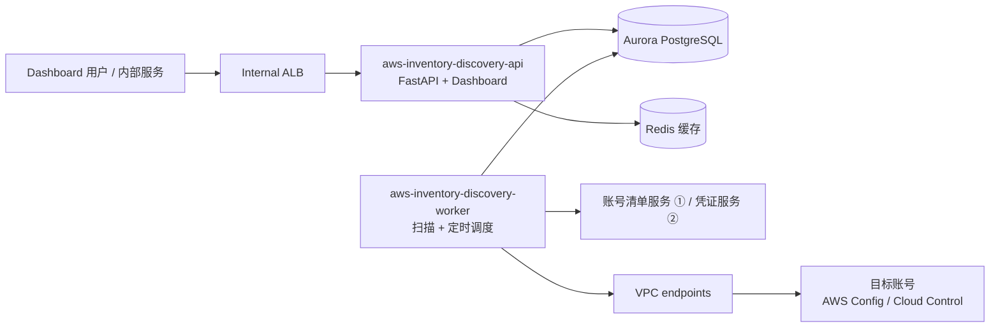

# aws-inventory-discovery

发现组织内 1000 多个 AWS 账号的资源，获取它们**当前的真实状态**，在 dashboard 上查询，并通过 API 提供给其他服务。

> **当前状态**：设计已完成，代码尚未开始。进度见 [docs/PROGRESS.md](docs/PROGRESS.md)。下文的命令在 M0（项目骨架）完成后可用。

## 它做什么

- 每 6 小时扫描一遍所有账号、所有可达区域的资源；也可以按账号、区域、类型随时扫描，或者实时刷新单个资源。
- 资源数据统一使用 AWS Config 的格式，可以按账号、EIM、BA、环境、区域、类型、标签以及各类型的专属字段筛选，并导出为 CSV 或 JSON Lines。
- 定时扫描和按需扫描同时进行时，数据不会出错；没删除的资源绝不会被标为删除。
- 只读：不修改任何 AWS 资源，不读取 secret 的值。

## 技术架构

完整的架构图是可交互的 HTML，在浏览器里打开 [docs/diagrams/architecture.html](docs/diagrams/architecture.html)。下面是简化版：



| 组件 | 说明 |
|---|---|
| `aws-inventory-discovery-worker` | 唯一调用目标账号 AWS API 的服务：扫描、写入、确认删除、定时调度、清理 |
| `aws-inventory-discovery-api` | REST API 和 dashboard；只读数据库、创建扫描请求，不调用目标账号 |
| Aurora PostgreSQL | 资产数据、账号、扫描任务（任务队列也在这里） |
| Redis | 只做缓存 |
| 数据来源 | 定时扫描用 AWS Config，Config 覆盖不到的用 Cloud Control；按需扫描和单资源刷新用 Cloud Control；两者都不支持的类型（AMI）用服务自己的 API |

**技术栈**

| 部分 | 选型 |
|---|---|
| 后端 | Python 3.14、FastAPI、SQLModel、Alembic、psycopg 3、boto3、uv、Ruff、ty |
| 前端 | React 19、Vite、TypeScript、TanStack Router / Query / Table、shadcn/ui、Tailwind v4、Biome、Playwright |
| 部署 | 一个镜像，两个 ECS Fargate 服务，ap-east-1 |
| 本地 | podman compose、moto、自带的 Cloud Control 模拟服务 |

## 代码结构

```
aws-inventory-discovery/
├── backend/
│   ├── app/
│   │   ├── main.py          # FastAPI 应用入口
│   │   ├── cli.py           # worker、doctor 命令
│   │   ├── core/            # 配置、数据库、日志
│   │   ├── models/          # 数据库表和 API 模型
│   │   ├── api/             # 路由和依赖
│   │   ├── query/           # 筛选、分类计数、导出
│   │   ├── types/           # 资源类型：注册表、映射、脱敏、每个类型的 JSON 配置、特殊处理（TYPE_HOOKS）
│   │   ├── aws/             # 与 AWS 和内部服务通信
│   │   └── worker/          # 任务队列、租约、Discovery（读取）、Writer（写入和删除判断）、调度、清理
│   ├── tests/               # 测试和样本数据（样本只来自 AWS 官方资料）
│   └── Dockerfile
├── frontend/                # Dashboard
├── devtools/                # 本地模拟服务和演示数据
├── deploy/                  # ECS 任务定义示例、部署清单
├── docs/                    # 设计、规格、决策、进度、架构图
└── compose.yaml
```

## 本地运行

需要：podman（含 `podman compose`）、uv、Node.js。

```bash
podman compose up -d
```

```bash
podman compose run --rm seed
```

然后打开 http://localhost:8000 。

本地环境里：

| 服务 | 作用 |
|---|---|
| postgres、redis | 数据库和缓存 |
| moto | 模拟 AWS Config、EC2、STS、CloudWatch Logs |
| fake-aws | 模拟 Cloud Control（moto 不支持）、账号清单服务、凭证服务 |
| api、worker | 本项目 |

程序通过 `AWS_ENDPOINT_URL` 和 `AWS_ENDPOINT_URL_CLOUDCONTROL` 环境变量连接到模拟服务，代码里没有只在本地生效的逻辑。演示数据是 20 个账号 × 4 个区域，由 AWS 官方资料整理的样本复制而来。

## 开发指导

### 后端

```bash
cd backend
uv sync
```

```bash
uv run ruff check . && uv run ruff format --check . && uv run ty check
```

```bash
uv run pytest
```

```bash
uv run alembic revision --autogenerate -m "describe the change"
```

- 写法参考 Frost Ming 的 [友好的 Python：面向对象接口](https://frostming.com/posts/2022/friendly-python-oop/) 和 [封装和复用](https://frostming.com/posts/2024/friendly-python-reuse/)，以及 FastAPI 自带的 skill 和 [full-stack-fastapi-template](https://github.com/fastapi/full-stack-fastapi-template)。
- 测试数据只来自样本文件或 API 返回，不在测试代码里构造数据；只写功能测试。

### 前端

```bash
cd frontend
npm install
npm run dev
```

后端接口有变化时重新生成 API 客户端（不要手改 `src/client/`）：

```bash
npm run generate-client
```

### 加一个资源类型

1. 在 `backend/app/types/specs/` 下加一个 JSON 配置文件（格式见 [docs/specs/resource-types.md](docs/specs/resource-types.md)）。
2. 在 `backend/tests/fixtures/aws/<类型>/` 下放 Config 和 Cloud Control 的样本，并在 `SOURCE.md` 里写明出自哪篇 AWS 文档。
3. 只有配置文件表达不了的逻辑，才写成函数，放进这个类型的 `Hooks` 对象，并登记到 `backend/app/types/hooks.py` 的 `TYPE_HOOKS`。
4. 运行测试：新类型会被自动覆盖。

## 部署

- 一个镜像（`backend/Dockerfile`），api 和 worker 用不同的启动命令。
- 每次发布：构建镜像 → 推送到 ECR `aws-inventory-discovery` → 运行一次性任务 `aws-inventory-discovery-migrate` → 滚动更新两个服务。
- 平台需要创建的资源（endpoint、私有托管区、IAM、安全组等）见 [deploy/CHECKLIST.md](deploy/CHECKLIST.md)。
- 环境变量见 [docs/DESIGN.md](docs/DESIGN.md) 12.3。

## 文档

| 文档 | 内容 |
|---|---|
| [docs/DESIGN.md](docs/DESIGN.md) | 完整设计 |
| [docs/DECISIONS.md](docs/DECISIONS.md) | 关键决策及原因 |
| [docs/PROGRESS.md](docs/PROGRESS.md) | 里程碑和任务进度 |
| [docs/specs/scanner.md](docs/specs/scanner.md) | 扫描的详细规格 |
| [docs/specs/resource-types.md](docs/specs/resource-types.md) | 资源类型配置格式和 v1 类型清单 |
| [docs/specs/api.md](docs/specs/api.md) | API 规格 |
| [docs/specs/dashboard.md](docs/specs/dashboard.md) | Dashboard 规格 |
| [docs/diagrams/](docs/diagrams/) | 架构图（部署架构、扫描流程、资源状态、数据库） |
| [deploy/CHECKLIST.md](deploy/CHECKLIST.md) | 部署清单 |
| [CLAUDE.md](CLAUDE.md) | 给 AI 编程助手的项目说明（`AGENTS.md` 是它的软链接） |
