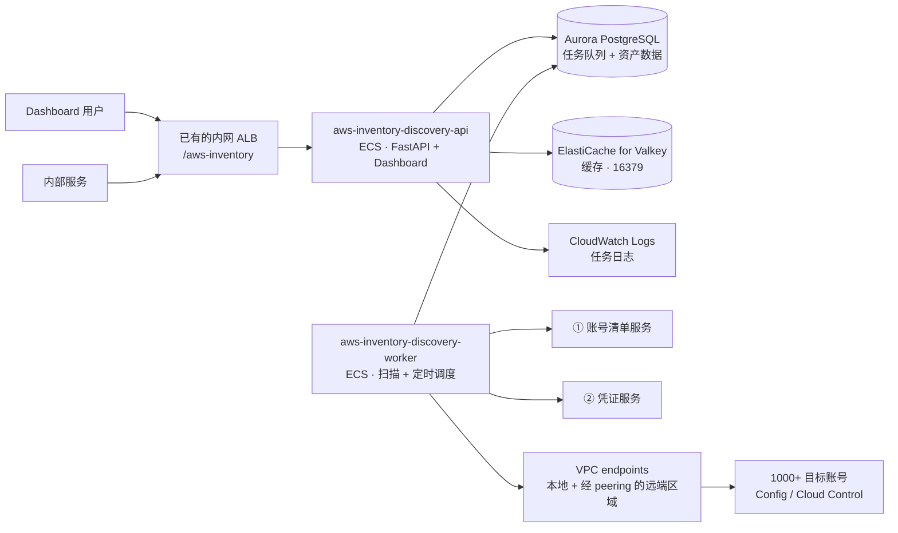

# AWS 资产发现：设计文档

最后更新：2026-11-09

## 1. 目标与范围

**目标**：定时并按需地发现组织内 1000 多个 AWS 账号的资源，获取资源**当前的真实状态**，通过 dashboard 查询，通过 API 提供给其他服务；定时扫描和按需扫描同时进行时，数据不能出错。

**v1 包含**
- 每 6 小时一轮全量扫描；按账号 + 区域 + 类型发起按需扫描；按 ARN 或 ID 刷新单个资源
- 资源类型（共 15 个），代码设计成方便以后加类型：
  - **第一批（重点）**：VPC、Subnet、ALB/NLB、ECS（Cluster / Service / Task Definition）、EC2、AMI（只包括账号自有的和共享给账号的）、Lambda、Secrets Manager Secret、SNS、SQS；以及每个账号开启的区域
  - **第二批**：Security Group、Target Group、Route 53 Hosted Zone
- Dashboard：概览、资源列表、资源详情、账号、扫描
- 对外 API：查询、筛选、导出（CSV / JSON Lines）、发起扫描

**v1 推迟**（见第 14 节）
- 巡检规则、推送通知、外部告警
- 应用内登录，访问由网络层控制
- 费用数据和运行时指标

**不在范围内**
- 变更历史：只保留资源的当前状态。需要历史时，用 AWS Config 自带的配置历史和 CloudTrail
- 修改任何 AWS 资源
- 读取 secret 的值

## 2. 背景与约束

| 项目 | 情况 |
|---|---|
| 部署账号 | 一个 hub 账号，主区域 ap-east-1，应用部署在这里 |
| 已开启区域 | ap-east-1、us-east-1、eu-west-1、eu-west-2，以后可能增加 |
| 网络 | 每个区域一个私有 VPC。ap-east-1 通过 VPC peering 访问其他三个区域的 interface endpoint |
| 数据存储 | 已有的 Aurora PostgreSQL（已为本服务分配独立 schema）；专用的 ElastiCache for Valkey（cluster mode disabled，自定义端口 16379），只做缓存 |
| 目标账号 | 同一个组织内 1000 多个账号，每个账号都有 ADFS-readonly 角色（AWS 托管的 ReadOnlyAccess 策略） |
| AWS Config | 每个账号都已开启，按账号调用，**没有组织级聚合器** |
| 账号清单服务 ① | 返回 `account_id、account_name、account_type（dev/preprod/prod）、eim_id（8 位字符串）、eim_app、ba_id（如 BA2011234）`。EIM 是一个应用的资源集合：EIM ID、BA ID、应用名各自唯一、一一对应；每个账号只属于一个 EIM，一个 EIM 通常有 dev、preprod、prod 各一个账号。**接口格式暂按假设实现，上线前确认** |
| 凭证服务 ② | 返回目标账号 ADFS-readonly 角色的临时凭证，**自带缓存**。**接口格式暂按 STS 格式假设，上线前确认** |

## 3. 架构



| 组件 | 职责 |
|---|---|
| 数据生产服务 `aws-inventory-discovery-worker` | **唯一**调用目标账号 AWS API、唯一持有目标账号凭证的服务；负责扫描、写入数据、确认删除、定时调度、定期清理 |
| 数据消费服务 `aws-inventory-discovery-api` | 提供 REST API，托管 dashboard；读数据，创建扫描请求。**不调用目标账号**，唯一访问的 AWS 服务是 hub 账号自己的 CloudWatch Logs，用来显示任务日志 |
| Aurora PostgreSQL | 唯一的数据源：资产数据、账号、扫描请求和任务（任务队列）、范围租约 |
| ElastiCache for Valkey | 只做缓存：分类计数、概览统计、筛选后的资源计数、账号 / 应用列表和扫描页摘要，key 以 `aws-inventory-discovery:<DATABASE_SCHEMA>:` 开头（多个部署共用一个缓存实例时，schema 不同的部署互不读到对方的缓存）。默认 60 秒，扫描页摘要 10 秒。cluster mode disabled，自定义端口 16379，私有子网 + 安全组 + TLS + AUTH，1 主 1 副本、Multi-AZ；不可用时只是变慢，数据不受影响 |

api 和 worker 只通过数据库协作：api 写扫描请求和任务，worker 领取并执行。worker 不接受任何直接调用。

## 4. 扫描

### 4.1 账号与凭证
- **账号清单**：每轮全量扫描开始时调用一次 ①，结果就是这一轮的扫描范围，同时更新账号表，供 dashboard 按 EIM、BA、环境筛选。清单里没有的账号标记为不活跃，30 天后清理数据。`POST /scans {all: true}` 由 API 先调用一次 ① 刷新账号快照。按需扫描指定了库里没有的账号时，API 先调用一次 ① 确认：清单里有就同步进来，没有返回 `account_not_found`。账号清单服务调用失败时用库里现有的快照，不把任何账号标为不活跃；清单为空也当作失败。
- **凭证**：每个任务开始时向 ② 要凭证，本服务不做缓存。用 botocore 的凭证提供器返回 `RefreshableCredentials`，过期时由 boto3 自动调用 ② 刷新。凭证只在内存里，不写数据库、Redis 或日志。

### 4.2 区域
- 每个账号开启了哪些区域，用 `ec2:DescribeRegions(AllRegions=true)` 查询，存到账号区域表。**调用的区域是 `REACHABLE_REGIONS` 里第一个默认开启（不是 opt-in）的区域**：ap-east-1 这样的 opt-in 区域在目标账号里可能没有开启，在那里调用会失败。`REACHABLE_REGIONS` 里没有默认开启的区域时，扫描任务明确失败并说明原因（要求加一个，比如 us-east-1）。opt-in 区域的清单来自 AWS 官方文档，写在 `aws/regions.py`。
- **扫描的区域 = 账号已开启的区域（`opt-in-not-required` 或 `opted-in`）∩ `REACHABLE_REGIONS`**（网络能到达的区域）。开启了但网络到不了的区域，dashboard 显示为「已开启，未扫描」。
- 增加区域：建 VPC、peering、endpoint、私有托管区，再改 `REACHABLE_REGIONS`。不用改代码。

### 4.3 数据源

| 场景 | 数据源 |
|---|---|
| 定时扫描：Config 持续记录的类型 | **AWS Config** `SelectResourceConfig`：每个账号、每个区域一次查询，覆盖所有记录的类型 |
| 定时扫描：Config 未开启、不支持，或只按天记录的类型 | **Cloud Control** `ListResources` / `GetResource` |
| 按需扫描（账号 + 区域 + 类型） | **Cloud Control**，拿实时数据 |
| 单个资源刷新 | **Cloud Control** `GetResource`，拿实时数据 |
| Config 和 Cloud Control 都不支持的类型（目前只有 AMI） | **服务自己的 API**：这个类型的 `Hooks` 对象（见 5.2）提供读取函数，定时、按需、刷新、删除确认都用它 |

**AMI**：用 EC2 `DescribeImages` 调用两次并按 AMI ID 合并：`Owners=["self"]` 得到账号自有的 AMI；`ExecutableUsers=["self"]` 得到共享给账号的 AMI（包括共享给账号所在组织或 OU 的）。两次都带 `IncludeDeprecated=true`、`IncludeDisabled=true`。不包括 Amazon 官方、Marketplace 和其他公开的 AMI。`OwnerId` 等于本账号的记为「自有」，否则记为「共享」。

每轮定时扫描先按账号、按区域读取 Config 记录器的配置：是否在记录、记录哪些类型（以及是否包含全局类型）、哪些类型只按天记录。再据此决定每个类型用哪个数据源；读取记录器失败时，所有类型都按 Cloud Control 读取。按需扫描不使用 Config，也不读取记录器。

### 4.4 扫描单元与调度
- **扫描单元（范围）**：账号 + 区域 + 类型。全局资源（Route 53）的区域记为 `global`。
- **全量扫描**：每 6 小时一次，由调度器创建一轮扫描。每个账号在窗口内有一个固定的开始时间（账号 ID 的 SHA-256 对窗口长度取模），把 1000 个账号错开。窗口 = 扫描间隔 − 30 分钟（默认 5.5 小时），保证最后一个账号在下一轮开始前有时间完成，平均每 20 秒左右开始一个。到点后由一个账号级任务拉起这个账号的所有区域和类型的子任务；定时扫描遇到上一轮还在排队的同范围子任务（积压）时不重复入队，按需扫描不去重。
- **定时调度**：在 worker 里运行，每分钟一次，用 Postgres advisory lock 保证只有一个实例负责。锁的 key 由 `<名称>:<DATABASE_SCHEMA>` 计算得出（名称是 `aws-inventory-discovery:scheduler`；共用一个数据库、schema 不同的部署互不干扰）。负责的实例还每分钟回收失联的任务，每天 03:00（UTC）清理。可以用环境变量 `SWEEP_ENABLED=false` 停掉定时扫描（回收和清理仍然运行）；本地环境就是这样做的，演示靠按需扫描。
- **任务种类**：`sweep_account`（账号级）、`config_group`（一个账号区域的一次 Config 查询）、`shard`（一个范围的 Cloud Control 扫描）、`resource`（单个资源刷新）、`confirm_missing`（删除确认）。
- **领任务**：`SELECT … FOR UPDATE SKIP LOCKED`，按需任务优先。每个 worker 留出一部分线程只处理按需任务。每个账号同时最多跑 4 个任务（可配置，软上限），用来避免被 Config 和 Cloud Control 限流。
- **重试**：boto3 用 `adaptive` 重试模式。任务失败最多重试 3 次，退避 30 秒 × 2^(次数−1) 加随机值；AccessDenied 不重试，直接记为「没有读取权限」。
- **读一页、写一页**：扫描一页一页地读取，每读到一页就写入，页与页之间检查是否被停止、取消或失去任务的所有权（检查点）。大的范围不会把所有数据攒在内存里，取消和关闭也能很快生效。
- **权限状态**：每个任务结束后重新计算账号表的 `access_status`（正常 / 部分无权限 / 没有读取权限 / 无法获取凭证），计算时锁住账号行，并发的任务不会互相覆盖。扫不到的账号保留现有数据，标记为过期，不告警。

## 5. 数据格式

### 5.1 统一使用 AWS Config 格式
所有资源都用 Config 配置项的字段名对外：`accountId`、`awsRegion`、`arn`、`resourceType`、`resourceId`、`resourceName`、`tags`（`[{key, value}]`）、`relationships`、`configuration`、`configurationItemCaptureTime`。

| 数据来源 | 处理方式 |
|---|---|
| Config | 原样存入（先脱敏） |
| Cloud Control | 按资源类型配置文件里的映射转成 Config 格式（见 5.2），**叠加**到库里现有的记录上。**叠加在写入时、锁住现有记录之后进行**，避免用旧快照覆盖并发的更新。规则：映射覆盖到的字段一律以 Cloud Control 为准，Cloud Control 返回里没有就视为被清空；映射覆盖不到的字段保留原来的值。Cloud Control 的原始属性脱敏后另存一份到 `live_raw`，映射改了以后可以直接重新转换，也方便排查 |
| Config 不支持的类型（包括用服务自己的 API 读取的 AMI） | 只用默认规则转换，外层字段同样用 Config 格式 |
| Cloud Control 没有 ARN 的类型 | 按类型配置里的 ARN 模板拼出来 |

**资源的唯一标识是 账号 + 区域 + 类型 + 资源 ID，ARN 不要求唯一。** 原因是 AMI 的 ARN 不带账号（`arn:aws:ec2:<区域>::image/<ami-id>`），一个共享给多个账号的 AMI 在每个账号下 ARN 都相同。共享 AMI 在每个能看到它的账号下各存一行，这和 Config 按账号记录资源的做法一致。

### 5.2 资源类型配置文件
每个类型一个 JSON 文件（`backend/app/types/specs/aws.ec2.vpc.json`），包含这个类型的全部配置：
- **身份标识**：Cloud Control 的 Identifier 对应 Config 里哪个字段；ARN 从哪个属性取，或者用什么模板拼；资源名称从哪里取（某个路径、某个标签，或 ARN 的最后一段，写作 `tail:<路径>`）。
- **数据来源**：Config 是否支持，Cloud Control 是否支持；两者都不支持时，由这个类型的 `Hooks` 对象提供服务 API 读取函数（如 AMI）。
- **映射**：每个类型选一种键风格（`mapping.keyCase`）：`camel`（默认，字段名首字母改成小写，嵌套字段也一样）或 `pascal`（保持 Cloud Control 的 PascalCase）。Config 的键风格因类型而异：VPC、Subnet、LoadBalancer、Instance、Lambda 是 lowerCamelCase，ECS、Secret、SNS、SQS、Route 53 保留 PascalCase（M1 核对）。文件里列出映射覆盖的 Cloud Control 属性（`mapping.properties`，叠加时靠它知道哪些字段「被清空」），再写例外：`rename`、`exclude`、`transform`（如 Config 里布尔值是字符串 `"true"` / `"false"`，用 `toString`）。覆盖的路径只能整体替换数组，不能穿过数组（加载时拒绝）。
- **脱敏字段**：要脱敏的字段路径。
- **会自己变化的字段**：存下来，但不参与内容哈希。
- **列定义**：dashboard 上的类型专属列，包括显示名称（中英文）、数据类型、取值路径。

加一个新类型，大多数情况只需要加一个这样的文件。

**特殊逻辑：每个类型最多一个 `Hooks` 对象。** 配置文件表达不了的逻辑写成普通函数，放进这个类型的 `Hooks` 对象，再登记到 `types/hooks.py` 里的一个显式字典 `TYPE_HOOKS`。`Hooks` 的每个字段都是可选的，没设置就用默认实现：

| 字段 | 默认实现 | 例子 |
|---|---|---|
| `list_live` | Cloud Control `ListResources` | AMI：EC2 `DescribeImages` |
| `get_live` | Cloud Control `GetResource` | AMI：`DescribeImages(ImageIds=[…])` |
| `filter` | 不过滤 | 目前没有类型使用 |
| `enrich` | 不补充 | 以后需要补充数据或关联时使用 |
| `cloudcontrol_identifier` | 用库里存着的 `configuration` 拼出 Identifier | ECS Service：从 Service ARN 得到 `<Service ARN>\|<Cluster ARN>`；ECS Cluster：从 Cluster ARN 得到集群名。用于刷新库里还没有的资源 |

目前登记的钩子：AMI（`list_live`、`get_live`）、ECS Service 和 ECS Cluster（`cloudcontrol_identifier`）。**ECS Service 不需要 `list_live`**：Cloud Control 的 list handler 自己会枚举集群。**ECS Task Definition 没有 `filter`**：Cloud Control 没有 `Status` 和 `Revision`，「每个 family 只保留最新的 ACTIVE 版本」算不出来，所以所有 ACTIVE 的版本都入库（见 D-24）。

这样，一个类型的特殊处理集中在一处，整个系统有哪些特殊处理打开 `TYPE_HOOKS` 就能看到；不用继承，也没有自动注册。钩子只负责**读取和补充数据**：选数据源、租约和扫描完整性由编排层负责；合并、脱敏、写入和删除判断由 Writer 统一负责（见 10.1），钩子碰不到。

### 5.3 脱敏
由 Writer 在写库前统一执行，时间点是叠加和补充数据之后、计算内容哈希之前，这是唯一的脱敏关卡。数据库里任何地方都不会有明文，包括 `live_raw`：
- Lambda、ECS 的环境变量：保留变量名，值替换成 `"***"`
- SNS 订阅：只保留协议和数量
- EC2 的 `userData`：丢弃

### 5.4 关系
- 只用 Config 提供的 `relationships`。从 Cloud Control 的属性推导关系推迟到以后。
- 资源上原样保留 `relationships` 数组；另存到关系表，用来反查（这个 VPC 里有哪些资源、这个安全组被谁用了），并对应到库里的资源，方便跳转。关系指向的资源还没入库时，`to_resource_id` 先为空，目标资源入库时再补上（迟到的解析）。
- 关系的变化不算资源变化：只有关系变了（按集合比较），只更新关系和关系表，不计入「更新」，也不改 `last_changed_at`。

### 5.5 只保留当前状态
- 不做变更历史。需要查看历史时，用 AWS Config 自带的配置历史和 CloudTrail。
- **内容哈希**：根据名称、tags、`configuration` 计算，不包括会自己变化的字段。哈希没变就不写库，每 6 小时扫描几百万条资源也不会产生大量写入。
- 保留 `first_seen_at`、`last_changed_at`。已删除的资源只标记 `deleted_at`，30 天后清理。

## 6. 数据库

所有表都放在 `DATABASE_SCHEMA` 指定的 schema 里（已为本服务分配的独立 schema），连接时设置 `search_path`；Alembic 的版本表也放在这个 schema。共 7 张表。下面的 DDL 是迁移 0001–0003 之后的结果（0001 初始表；0002 加围栏令牌和运行中任务的索引；0003 加 `candidate_count`）；三列 trigram 索引需要 `pg_trgm` 扩展，迁移里用 `CREATE EXTENSION IF NOT EXISTS pg_trgm SCHEMA public`（共享集群上通常已经装好）。

```sql
-- 账号快照：每轮全量扫描开始时，从账号清单服务 ① 更新
CREATE TABLE t_inv_aws_account (
  account_id           char(12) PRIMARY KEY,
  account_name         text        NOT NULL,
  account_type         text        NOT NULL,          -- dev / preprod / prod
  eim_id               char(8),
  eim_app              text,
  ba_id                text,
  active               boolean     NOT NULL DEFAULT true,
  inactive_since       timestamptz,                   -- 超过 30 天就清理数据
  registry_fetched_at  timestamptz NOT NULL,
  access_status        text        NOT NULL DEFAULT 'unknown',
                       -- unknown / ok / partial / access_denied / credential_error
  access_error         text,
  access_checked_at    timestamptz,
  last_scan_ok_at      timestamptz
);
-- 索引：account_type、eim_id、ba_id、access_status

-- 每个账号开启的区域，以及该区域的 Config 记录器配置
CREATE TABLE t_inv_aws_account_region (
  account_id       char(12) REFERENCES t_inv_aws_account,
  region           text,
  opt_in_status    text        NOT NULL,
  reachable        boolean     NOT NULL,   -- 在不在 REACHABLE_REGIONS 里
  config_recorder  jsonb,                  -- {recording, allSupported, includeGlobal, resourceTypes[], excludedTypes[], dailyTypes[]}；只有定时扫描会更新
  checked_at       timestamptz NOT NULL,
  PRIMARY KEY (account_id, region)
);

-- 资源当前状态（Config 格式）
CREATE TABLE t_inv_aws_resource (
  id                   bigint GENERATED ALWAYS AS IDENTITY PRIMARY KEY,
  arn                  text        NOT NULL,          -- 不唯一：共享 AMI 在多个账号下 ARN 相同
  account_id           char(12)    NOT NULL REFERENCES t_inv_aws_account,
  aws_region           text        NOT NULL,          -- 全局资源为 'global'
  resource_type        text        NOT NULL,          -- AWS::EC2::VPC
  resource_id          text        NOT NULL,
  resource_name        text,
  tags                 jsonb       NOT NULL DEFAULT '[]',
  configuration        jsonb,                         -- Config 格式，已脱敏，已叠加映射结果
  relationships        jsonb       NOT NULL DEFAULT '[]',
  live_raw             jsonb,                         -- Cloud Control 原始属性，已脱敏
  config_capture_time  timestamptz,
  live_observed_at     timestamptz,
  observed_at          timestamptz NOT NULL,          -- 最近一次被接受的观察时间，包括「明确不存在」的观察（见 7.2 R4、R5）
  observed_source      text        NOT NULL,          -- config / cloudcontrol / native
  content_hash         text        NOT NULL,
  status               text        NOT NULL DEFAULT 'active',   -- active / missing / deleted
  missing_since        timestamptz,                   -- 从什么时候开始「可能已删除」
  absent_in_scan_at    timestamptz,                   -- 删除的第一条证据：最近一次完整扫描没看到它的时间；再次被看到时清空
  missing_checks       smallint    NOT NULL DEFAULT 0,
  deleted_at           timestamptz,
  first_seen_at        timestamptz NOT NULL,
  last_changed_at      timestamptz NOT NULL,
  last_task_id         bigint,
  UNIQUE (account_id, aws_region, resource_type, resource_id)   -- 资源的唯一标识
);
-- 索引：arn；(resource_type, status)；(account_id, aws_region, resource_type) WHERE status <> 'deleted'；
--       GIN(tags jsonb_path_ops)；GIN trigram(resource_name)、trigram(arn)、trigram(resource_id)；
--       唯一约束 uq_t_inv_aws_resource_identity 就是 (account_id, aws_region, resource_type, resource_id)；
--       常用的类型专属列，按需加表达式索引（目前没有）

-- 关系：用于反查
CREATE TABLE t_inv_aws_resource_relation (
  from_resource_id  bigint NOT NULL REFERENCES t_inv_aws_resource ON DELETE CASCADE,
  to_resource_type  text   NOT NULL,
  to_resource_key   text   NOT NULL,     -- Config 给的 resourceId
  to_resource_id    bigint REFERENCES t_inv_aws_resource ON DELETE SET NULL,  -- 找不到对应资源时为空
  relation_name     text   NOT NULL,
  PRIMARY KEY (from_resource_id, to_resource_type, to_resource_key, relation_name)
);
-- 索引：to_resource_id

-- 扫描请求：一次 API 调用或一轮定时扫描对应一行
CREATE TABLE t_inv_aws_scan_request (
  id               bigint GENERATED ALWAYS AS IDENTITY PRIMARY KEY,
  trigger          text        NOT NULL,   -- schedule / api
  caller_id        text,
  scope            jsonb,                  -- {accountIds[], awsRegions[], resourceTypes[], all}
  target           jsonb,                  -- 单个资源
  priority         smallint    NOT NULL,   -- 0 = 按需，1 = 定时
  status           text        NOT NULL,   -- queued / running / succeeded / partial / failed / cancelled
  counts           jsonb,                  -- {tasks: {状态: 数量}, resources: {new, updated, missing, deleted}}，由任务结束时汇总；另有 accounts、skippedAccounts、registryError 等
  idempotency_key  text        UNIQUE,
  created_at       timestamptz NOT NULL DEFAULT now(),
  started_at       timestamptz,
  finished_at      timestamptz
);

-- 扫描任务，也就是任务队列
CREATE TABLE t_inv_aws_scan_task (
  id               bigint GENERATED ALWAYS AS IDENTITY PRIMARY KEY,
  scan_request_id  bigint      NOT NULL REFERENCES t_inv_aws_scan_request,
  kind             text        NOT NULL,   -- sweep_account / config_group / shard / resource / confirm_missing
  source           text,                   -- config / cloudcontrol / native
  account_id       char(12)    NOT NULL,
  region           text,
  resource_type    text,
  resource_id      text,
  priority         smallint    NOT NULL,
  status           text        NOT NULL,   -- queued / running / succeeded / failed / skipped / coalesced / cancelled
  not_before       timestamptz NOT NULL DEFAULT now(),
  attempt          smallint    NOT NULL DEFAULT 0,
  max_attempts     smallint    NOT NULL DEFAULT 3,
  worker_id        text,
  claim_token      text,                   -- 每次领取生成的围栏令牌，心跳、租约、检查点、结束任务都要出示（见 7.2 R1）
  heartbeat_at     timestamptz,
  observed_at      timestamptz,
  coalesced_into   bigint REFERENCES t_inv_aws_scan_task,
  stats            jsonb,                  -- 随每批写入在同一个事务里累加：new、updated、unchanged、restored、missing、deleted；各任务另有自己的键（如 regions、tasks、types、skipped、checked）
  error_code       text,
  error_message    text,
  created_at       timestamptz NOT NULL DEFAULT now(),
  started_at       timestamptz,
  finished_at      timestamptz
);
-- 索引：(priority, not_before) WHERE status = 'queued'；scan_request_id；
--       (account_id) WHERE status = 'running'，用于领任务时统计每个账号正在跑的任务数
-- 唯一索引：(account_id, region, resource_type, resource_id)
--           WHERE kind = 'resource' AND status IN ('queued', 'running')，用于单个资源刷新的去重

-- 扫描范围：租约、最近一次成功、删除保护
CREATE TABLE t_inv_aws_scan_shard (
  id                    bigint GENERATED ALWAYS AS IDENTITY,  -- 唯一；API 用它指代一个范围（scanShardId）
  account_id            char(12),
  region                text,
  resource_type         text,
  lease_task_id         bigint,
  lease_expires_at      timestamptz,
  lease_token           text,             -- 持有租约的任务的 claim_token
  pending_task_id       bigint,           -- 排在后面的按需任务，最多一个
  last_started_at       timestamptz,
  last_succeeded_at     timestamptz,
  last_task_id          bigint,
  last_error_code       text,
  consecutive_failures  int  NOT NULL DEFAULT 0,
  guard_state           text NOT NULL DEFAULT 'normal',   -- normal / abnormal / confirmed
  guard_detected_at     timestamptz,
  guard_confirmed_by    text,
  candidate_count       int,              -- 触发保护的那次扫描想标为 missing 的资源数
  candidate_ids         jsonb,            -- 这些资源的 [{resourceId, arn}]；范围恢复 normal 时清空
  PRIMARY KEY (account_id, region, resource_type)
);
```

**清理**（worker 每天凌晨执行一次）
- 任务明细保留 14 天，扫描请求保留 90 天
- 已删除的资源保留 30 天
- 从清单移除超过 30 天的账号，连同它的资源一起清理

## 7. 并发与一致性

### 7.1 要防止的情况

| # | 情况 | 后果 |
|---|---|---|
| A | 定时扫描和按需扫描同时扫同一个范围 | 重复调用 AWS，写入交错 |
| B | 一个慢的列表扫描（T0 开始）在单个资源刷新（T1）之后才写入 | T0 的旧数据覆盖 T1 的新数据 |
| C | 资源在列表扫描之后才创建，删除判断时它不在列表里 | 新资源被误标为删除 |
| D | 扫描被限流或中途失败 | 没扫到的资源被误标为删除 |
| E | 调用方重试 `POST /scans` | 产生重复的扫描请求 |
| F | worker 中途挂掉 | 租约一直被占着，这个范围再也不会被扫描 |
| G | Config 还没记录到刚创建或刚修改的资源 | 实时观察到的资源被误删，或被更早的 Config 记录覆盖 |
| H | 映射或权限出问题，导致大量资源「消失」 | 大批资源被误标为删除 |

### 7.2 规则

**R1：同一个范围同时只跑一个任务（租约）。** 任务开始前先取得这个范围在 `t_inv_aws_scan_shard` 上的租约；租约被别人占着就不执行。运行期间定期续约，结束时释放；worker 挂了，租约到期后会自动失效。`config_group` 一开始就取得它覆盖的所有类型的租约，读取期间一直持有。`resource`（单个资源刷新）不取租约：R4 保护它的写入，任务表上的部分唯一索引给它去重。（解决 A、F）

**围栏令牌**：每次领取任务生成新的 `claim_token`，租约上记着持有者的令牌（`lease_token`）。心跳、取得和续约租约、释放租约、检查点、结束任务都必须出示当前的令牌。任务被回收并被别人重新领取后，旧令牌失效，旧 worker 的所有调用被拒绝；它收到后立即停止，什么都不再写。这样，一个只是卡住（而不是挂掉）的 worker 醒来后，不会和新的持有者互相覆盖，也不会去释放新持有者的租约。

**加锁顺序**：所有事务按同一个顺序取行锁：范围行 → 任务行（按 id）→ 扫描请求行（按 id），不回头，所以取消、领取、结束任务不会互相等待成死锁。

**R2：合并请求，最多排一个后续任务。** 范围正忙的时候：
- 新来的定时任务直接跳过，因为正在跑的任务已经覆盖了。
- 新来的按需任务排在后面（`pending_task_id`，最多一个）。租约释放后立即执行，保证调用方拿到的是**请求之后**观察到的数据。原来已经排着一个时，**只有新任务能覆盖它**（种类、范围、数据源都相同）才把它合并进来；覆盖不了的新任务不占这个位置，等租约到期后再试，所以合并永远不会让某个请求拿不到它要的数据。
- 一个排队的任务可能被多个请求共用。取消一个请求时，只有没有别的请求还需要的任务才被取消；共用的任务继续跑，直到所有需要它的请求都被取消。

**R3：跳过刚扫过的范围。** 定时任务遇到 30 分钟内刚成功扫描过的范围，直接跳过；按需任务从不跳过。`confirm_missing` 也不受限制，它紧接在刚成功的扫描之后。

**R4：旧数据不覆盖新数据。** 每次写入都带观察时间：Cloud Control 用调用之前的时间，Config 用它的 `configurationItemCaptureTime`。写入是有条件的：

```sql
INSERT INTO t_inv_aws_resource (...) VALUES (...)
ON CONFLICT (account_id, aws_region, resource_type, resource_id) DO UPDATE SET ...
WHERE t_inv_aws_resource.observed_at < EXCLUDED.observed_at;
```

不管数据来自哪个任务，更早的观察都覆盖不了更新的观察。（解决 B、G）

**R5：删除要有两条独立的证据。**
1. 只有**完整成功**的扫描（所有分页都拿到了）才能判断哪些资源「没看到」。失败、被限流的扫描一律不做判断。（解决 D）
2. 只有在这次扫描开始之前就没再被观察到的资源，才算「没看到」：`observed_at < 扫描开始时间`。Config 来源的扫描再往前多留 15 分钟（`CONFIG_LAG_GRACE_MINUTES`），等 Config 的延迟。（解决 C、G）
3. 「没看到」的资源先标为 `missing`（可能已删除），并记下 `absent_in_scan_at`（**第一条证据**）。**这不是删除**，dashboard 上照常显示，带一个标记。
4. 对每个 `missing` 的资源按 ID 实时读取一次（**第二条证据**）：
   - 读取函数明确返回「不存在」→ 如果已有第一条证据，确认删除，写入 `deleted_at`
   - 返回了资源 → 恢复为 `active`，清空两条证据，并记一条日志
   - 其他任何错误（没权限、被限流、这个类型不支持读取）都**不算**「不存在」→ 保持 `missing`，下一轮再试
   - 「不存在」的判断：Cloud Control 是 `ResourceNotFoundException`；Cloud Control 读不了的类型看 Config 的状态，`ResourceDeleted` 或 `ResourceDeletedNotRecorded` 才算；用服务自己的 API 读取的类型由它的读取函数判断，比如 AMI 是 `DescribeImages(ImageIds=[…])` 返回空、`InvalidAMIID.NotFound` 或状态为 `deregistered`。共享 AMI 被所有者停止共享后，在这个账号里也会这样消失，界面上显示为「已删除或不再共享」
5. **单个资源刷新时发现不存在**：只有第二条证据。资源原来是 `active` 的，只改为 `missing`；要等下一次完整扫描也没看到它（补上第一条证据），删除确认时才会标为删除。资源原来就是 `missing` 并且已有第一条证据的，直接确认删除。
6. 删除的写入同样遵守 R4：「不存在」的观察时间必须晚于资源现有的 `observed_at`，否则不处理。被接受的「不存在」观察（不管结果是 `missing` 还是 `deleted`）也把 `observed_at` 推进到这个时间，这样更早开始、还没写完的列表扫描无法再把它「恢复」。
7. **一直确认不了，就永远保持 `missing`，不会自动删除。**
8. 已删除的资源又被扫描到，就恢复为 `active`。

**R6：超过一半的资源消失时，整批不处理。** 如果一次扫描会让某个范围里超过 50%、且多于 20 个资源变成 `missing`，这一批全部不处理，把这个范围标为 `abnormal`，在扫描页显示。触发保护时同时保存这一批候选资源的 ID，供核对页逐条查看；范围恢复正常时清除。管理员可以「重新扫描」；或者「确认是真实变化」，设为 `confirmed`，之后这批资源仍然要逐个按 R5 第 4 步确认，**不会直接删除**。（解决 H）

**R7：请求去重。** `POST /scans` 支持 `Idempotency-Key`，同一个 key 返回原来的扫描请求。单个资源刷新靠任务表上的部分唯一索引去重：同一个资源同时只能有一个刷新任务。创建全量扫描（调度器和 `POST /scans {all: true}`）用一个事务级 advisory lock（`aws-inventory-discovery:full-sweep`，同样按 schema 区分）串行化：检查有没有正在跑的全量扫描、再创建，两步在锁内完成，同时到达的请求只会创建一轮。（解决 E）

**R8：按需任务优先。** 领任务时按需任务排在前面，并且每个 worker 有一部分线程只处理按需任务，全量扫描不会拖慢单个资源刷新。

**R9：worker 挂掉的处理。** 任务的心跳超时（2 分钟）后，由负责调度的 worker 放回队列并清掉令牌（旧 worker 被围栏挡在外面）；领取时 `attempt` 已经加过一，次数用完就标为失败（`worker_lost`）。范围租约不由回收释放，它在最后一次续约 5 分钟后自己到期，重新领取这个任务的 worker 会接管它。（解决 F）

### 7.3 举例

```
T0  定时扫描（账号 A，us-east-1，SQS）拿到租约，列出队列 → 看到 q1、q2
T1  刷新 q2（GetResource）→ q2 的属性变了，写入，observed_at = T1
T1  刷新新建的队列 q3 → 写入，observed_at = T1
T2  定时扫描写入 q1、q2，observed_at = T0
      q1 写入成功；q2 被拒绝（T0 < T1，R4）
    删除判断：q3 不在列表里，但 observed_at = T1，晚于扫描开始时间 T0 → 不算「没看到」（R5）
```

## 8. API

### 8.1 通用约定

| 项目 | 约定 |
|---|---|
| 前缀 | `/api/v1`，OpenAPI 文档在 `/api/v1/openapi.json`，前端客户端由 hey-api 根据它自动生成。部署时整体挂在 `BASE_PATH` 下，生产是 `/aws-inventory/api/v1` |
| 字段命名 | camelCase，和 Config 格式一致；Python 代码里是 snake_case，用 Pydantic 别名转换 |
| 时间 | ISO 8601，UTC |
| 资源在路径里的标识 | 数据库 ID：`/resources/{id}`；按 ARN 查询用 `/resources/lookup?arn=`，返回列表（共享 AMI 的同一个 ARN 会出现在多个账号下，自有的排在前面） |
| 语言 | `Accept-Language`（`zh*` 或 `en*`，默认中文）决定列名、类型名、分类标签；导出可以用 `lang` 参数覆盖 |
| 分页 | `page` + `pageSize`（默认 50，最大 200），返回 `total` |
| 多值筛选 | 重复传参数，表示「或」 |
| 排序 | `sort=-configurationItemCaptureTime,resourceName` |
| 请求头 | `X-Caller-Id`（可选，dashboard 传 `dashboard`）；`Idempotency-Key`（只用于 `POST /scans`） |
| 错误格式 | `{"code": "...", "message": "...", "details": {...}}`，HTTP 状态码照常；全部错误码见 [specs/api.md](specs/api.md) 1.2 |
| 鉴权 | 不自己做登录，访问由网络层控制（内网 ALB、安全组）；当前设计阶段用假身份展示，正式接入时由网关传入，仅用于显示 |

### 8.2 资源筛选参数
列表、分类计数、概览统计和导出四个接口用同一套，后端用一个参数模型 `Annotated[ResourceFilter, Query()]` 统一接收。

| 参数 | 说明 |
|---|---|
| `accountId`、`eimId`、`baId`、`accountType`、`awsRegion`、`resourceType` | 等于（可多值） |
| `status` | `active` / `missing` / `deleted`，默认 `active` + `missing` |
| `q` | 名称、ARN、资源 ID 模糊搜索 |
| `tag=key:value` / `tag=key` / `tagMissing=key` | 有这个标签且值等于（按第一个冒号切分）/ 有这个标签 / 缺少这个标签；重复的 `tag` 是「或」，重复的 `tagMissing` 是「且」 |
| `configurationItemCaptureTime`、`firstSeenAt`、`lastChangedAt`、`missingSince`、`deletedAt` 加 `.gte` / `.lte` | 时间范围；扫描页「新增 12」「已删除 2」这类数字，跳转到资源列表时就是用它们筛选 |
| `attr.<列>=值`、`attr.<列>.gte=`、`attr.<列>.lte=` | 类型专属列，只能在指定了一个 `resourceType` 时使用；列名和取值路径来自资源类型配置；和通用列重名的列（ECS Task Definition 的 `status`）也一律加 `attr.` 前缀 |
| `scanRequestId` | 只列这次扫描范围（解析后的账号、区域、类型）里的当前资源；显示的是当前清单，不代表这次扫描当时的结果。扫描创建后的任务明细保留期（14 天）内，范围按这次扫描的任务计算；之后任务明细可能已经清理，改按扫描请求里记录的范围计算 |

不认识的参数返回 `400 invalid_filter`。分类计数计算某个字段时不应用这个字段自己的筛选条件（`status` 也一样，所以能看到各状态的数量）。`stale`（数据过期）指资源所在范围从没成功扫描过，或最近一次成功扫描超过 12 小时前。

### 8.3 接口清单

| 方法 | 路径 | 用途 |
|---|---|---|
| GET | `/resources` | 列表：筛选、搜索、排序、分页。不返回 `configuration` 和 `live_raw`，只返回列需要的 `attrs` 和 `relationshipCount` |
| GET | `/resources/facets?field=...` | 分类计数，给筛选下拉框用；带上当前筛选条件；缓存在 Redis |
| GET | `/resources/summary` | 当前筛选条件下的去重计数（资源、账号、应用、类型、区域），在 SQL 里算，不受分类计数 200 个选项的上限影响；给概览页和服务页 / 分组页的统计用 |
| GET | `/resources/export?format=csv\|jsonl&lang=` | 流式导出当前筛选结果：CSV 是 `columns` 指定的列（默认全部），JSON Lines 是完整记录（Config 格式）；`lang` 指定 CSV 表头的语言 |
| GET | `/resources/lookup?arn=` | 按 ARN 查询，返回列表 |
| GET | `/resources/{id}` | 详情：Config 格式、实时数据、账号信息 |
| GET | `/resources/{id}/relationships?direction=out\|in\|both` | 关联资源，分页 |
| POST | `/resources/refresh?wait=20` | 刷新单个资源。请求体主要用 `{accountId, awsRegion, resourceType, resourceId}`，永远没有歧义，也能刷新库里还没有的资源；也可以只传 `{arn}`（只能刷新库里已有的），但如果这个 ARN 在库里对应多个账号（共享 AMI），返回 `409 ambiguous_arn` 并列出账号。`resourceId` 就是 Config 格式里的 `resourceId`，系统按类型规则在内部换算成 Cloud Control 的 Identifier：库里有就用存着的配置，没有就由类型钩子推出（ECS Service、ECS Cluster 都用 ARN 作为 `resourceId`）。扫描页的「再检查一次」也用它。账号已不活跃时按不存在处理（404 `account_not_found`）。 |
| GET | `/resource-types` | 支持的资源类型，带中英文名称 |
| GET | `/columns?resourceType=` | 列定义，不传类型时返回通用列；前端据此生成列和筛选控件 |
| GET | `/stats/overview` | 概览数据 |
| GET | `/accounts` | 账号列表 |
| GET | `/accounts/{accountId}` | 账号详情：信息、权限状态、开启的区域 |
| GET | `/accounts/{accountId}/coverage` | 「区域 × 类型」的扫描状态 |
| GET | `/applications` | 应用列表：按 `q` 搜索应用名、EIM、BA，分页；只统计活跃账号 |
| GET | `/scans/summary` | 扫描页上半部分：全量扫描进度、任务积压、按原因汇总的失败、可能已删除的数量、数据异常的范围 |
| POST | `/scans` | 发起扫描：`{accountIds, awsRegions?, resourceTypes?}` 或 `{all: true}`。超过 50 个账号返回 `scope_too_large`；库里没有的账号先向账号清单服务确认，也没有就返回 `account_not_found`；`all` 时先刷新账号快照，如果已经有一轮全量扫描在跑，就返回那一轮 |
| GET | `/scans` | 扫描记录 |
| GET | `/scans/{id}` | 扫描详情：任务按状态汇总，失败按原因分组 |
| GET | `/scans/{id}/tasks` | 任务列表，可以按状态、原因筛选 |
| POST | `/scans/{id}/retry-failed` | 重试失败的任务（已取消的扫描返回 `scan_cancelled`） |
| POST | `/scans/{id}/cancel` | 取消（已结束返回 `scan_not_cancellable`）。只取消没有别的扫描还需要的任务 |
| GET | `/tasks/{id}` | 任务详情 |
| GET | `/tasks/{id}/logs` | 任务日志：API 按任务 ID 和任务的时间范围，实时查 `/aws-inventory-discovery/worker` 日志组；查不到（本地环境没有这个日志组）返回 `dependency_unavailable` |
| GET | `/scan-scopes?guardState=abnormal` | 数据异常的扫描范围，返回 `scanShardId` |
| GET | `/scan-scopes/{id}/candidates` | 待核对范围的候选资源，分页；来自触发保护时保存的候选 ID |
| POST | `/scan-scopes/confirm-change` | 确认是真实变化：`{accountId, awsRegion, resourceType, guardDetectedAt}`（带上核对时看到的检测时间）；范围不存在返回 `scope_not_found`，当前不是 `abnormal` 返回 `scope_not_abnormal`，检测时间已变化返回 `409 scope_changed` |
| GET | `/health` | 健康检查：数据库、Redis（数据库不可用时 503，Redis 不可用时仍是 200） |

### 8.4 单个资源刷新的返回

| 情况 | 返回 |
|---|---|
| 20 秒内完成 | `200`，返回最新的资源详情 |
| 没有及时完成 | `202 {"taskId": ...}`，之后轮询 `/tasks/{id}` |
| AWS 里不存在，资源原来是 `active` | `200`，资源 `status` 变为 `missing`（只有一条证据，见 R5 第 5 条） |
| AWS 里不存在，资源原来是 `missing`，并且完整扫描也没看到它 | `200`，资源 `status` 变为 `deleted` |
| AWS 里不存在，库里也没有 | `404 resource_not_found` |
| 只传了 ARN，但对应多个账号 | `409 ambiguous_arn`，`details` 里列出账号 |
| 没有权限或被限流，库里有这个资源 | `200`，返回库里现有的数据，附带 `refreshError` |
| 没有权限或被限流，库里没有这个资源 | `502 refresh_failed` |

同一个资源有人正在刷新时，后来的请求共用同一个任务，只调用一次 AWS。

## 9. Dashboard

### 9.1 技术栈
和 full-stack-fastapi-template 一致：React 19、Vite、TypeScript、TanStack Router / Query / Table、shadcn/ui（Radix）、Tailwind v4、zod、Biome，API 客户端由 `@hey-api/openapi-ts` 生成（`backend/scripts/export_openapi.py` 导出 OpenAPI，`npm run generate-client` 生成）。构建产物由 FastAPI 的 `app.frontend()` 托管。没有用 react-hook-form（表单都很简单），Playwright 已接入（`frontend/e2e/`）；多语言用自己写的轻量实现，不用 react-i18next（见 D-29）。

### 9.2 使用者

| 使用者 | 主要做什么 | 主要页面 |
|---|---|---|
| 应用负责人、开发 | 查自己应用（EIM）的资源，看资源详情，刷新 | 搜索、资源列表、资源详情 |
| 日常云运维 | 跨账号按类型和类型专属列筛选，查没打标签的资源，导出 | 资源列表 |
| 管理者 | 看资源总量和分布 | 概览 |
| 系统管理员 | 看扫描状态和账号权限，发起扫描，处理异常 | 扫描、账号 |

### 9.3 页面

导航：左侧栏是 Inventory 服务树（Overall，以及计算、Serverless、网络、消息、安全分组下的服务）和扫描管理；左上角切换资源范围（全部应用和账号、单个应用、单个账号）。不自己做登录，当前设计阶段用假身份展示，正式接入时由网关传入，只用于显示；管理页由网络层控制访问，每个操作都记录触发方。

| 页面 | 内容 |
|---|---|
| **概览** | 范围相关的统计：资源总数、应用数、账号数（含无法访问的数量）、类型数和区域数；按服务、应用、账号、环境和区域的分布，点击跳到筛选好的资源列表；当前范围的资源列表；全局搜索只在顶栏，不单独放大搜索框 |
| **应用列表** | 按应用名、EIM、BA 搜索，按环境筛选；列应用名、EIM、BA、账号数、环境、资源数；点击进入这个应用的资源范围 |
| **资源列表** | 表格上方一行筛选（当前范围的搜索、环境、区域、类型、清单状态；账号、EIM、BA 和标签收在「更多筛选」里，选项带数量）；没选类型时显示通用列，选了一个类型后加上这个类型的专属列。**每一列的筛选控件按列的数据类型自动生成**，筛选和排序在后端执行；可以显示和隐藏列；导出；筛选条件都在 URL 里，可以收藏或分享。表格用「名称 / 资源 ID」、账号、应用、环境、区域、类型和类型列的固定布局，长值单行省略，完整值在悬停、预览侧栏和详情里；点击行打开预览，点击名称进详情。异常状态只在不正常时显示：「可能已删除」「已删除」「数据过期」。带 `scanRequestId` 时显示某次扫描范围内的当前清单，并写明不代表本次变化 |
| **资源详情** | 名称、类型、状态、「刷新」按钮；ARN（可复制）、账号、EIM、BA、环境、区域、首次发现时间；「更新于 3 分钟前」，悬停显示具体时间和数据来源；标签；关联资源（按关系分组，可跳转）；配置（Config 格式，可以折叠和搜索）；有实时数据时另起一块显示 |
| **账号** | 列表：名称、ID、环境、EIM、BA、资源数、权限状态、上次扫描时间，可以按状态筛选。详情：权限状态（直接写原因，比如「没有读取权限」）、区域（已扫描 / 已开启但未扫描）、「区域 × 类型」的状态格子、「扫描」按钮；从清单移除的账号显示「12 天后清理」 |
| **扫描**（管理） | 上半部分是当前状态：全量扫描进度和预计完成时间（比计划慢时提示「比计划慢了」，接口不返回计划完成时间，所以不写时长）、任务积压、最近 24 小时按原因汇总的失败（每个原因配一句白话说明和处理建议，点击跳到最近一次扫描的任务列表，因为没有全局的任务列表接口）、可能已删除的资源（「再检查一次」）、数据异常的范围（「核对资源」「重新扫描」）。下半部分是扫描记录：每次扫描的结果，比如「新增 12，更新 340，可能已删除 3，已删除 2，失败 5」，结果数字只作统计，失败可以跳到任务列表，另提供「查看当前范围资源」；扫描详情里可以「重试失败的任务」「取消」，任务详情里直接显示日志。「扫描」按钮打开表单：选账号（可以按名称、ID、EIM、BA 搜索，或选全部）、区域、类型，提交前写清范围；超过 50 个账号时在按钮旁直接提示 |
| **待核对的范围** | 从扫描页的异常范围进入：账号、区域、类型、检测时间、本次未发现的数量和当前总数；候选资源的名称、ID、ARN、本次未发现和保留的清单状态；明确「未发现不等于已删除」；「暂不确认」返回，「确认是真实变化」二次确认后重新扫描这个范围 |

### 9.4 用词

| 动作或概念 | 用词 |
|---|---|
| 实时更新单个资源 | 刷新 |
| 对账号或范围重新采集 | 扫描 |
| 下载数据 | 导出 |
| `account_type` | 环境：开发 / 预发布 / 生产 |
| `missing` | 可能已删除 |
| `access_denied` / `credential_error` | 没有读取权限 / 无法获取凭证 |
| 时间 | 「3 分钟前」，悬停显示具体时间；超过一天直接显示日期 |
| 数字 | 加千分位，带单位，比如「128,430 个资源」 |

EIM、BA、ARN 以及 AWS 的类型名、字段名保持原样，不翻译。

### 9.5 外观与交互原则
- 界面默认中文，可以切换英文；所有文字放在语言文件里，布局按最长的译文来设计，不缩小字号、不截断。
- 自动跟随系统的亮色和暗色，也可以手动切换；风格简洁，偏工具型，信息密度高。
- 每页只用一个主色，不用橙色、赤陶色和老式后台的亮蓝色；所有灰色都是暖灰；配色从中国传统色里选，最终使用胭脂，黛绿和黛蓝不再作为可选配色。
- 每页最多四种字号，满足无障碍对比度要求。
- 等宽字体只用于 ID、ARN、代码和数值；不用斜体；按钮和标签不用全大写。
- 页面扁平：不叠加阴影，不用发光和毛玻璃，阴影只给真正浮在页面上的对话框，不在卡片里套卡片；嵌套的圆角保持同心。
- 只有不可撤销的操作才二次确认（v1 只有「确认是真实变化」一处）；不用大面积的红色。
- 界面已经说清楚的，不再加说明文字。
- 在 1440 和 1920 宽的桌面显示器上逐一检查；另检查 1024 和 390 宽，确认侧栏收起、表格横向滚动和对话框不溢出。

## 10. 代码结构

### 10.1 原则
- **Python 写法参考 Frost Ming**：
  - 多种构造方式用 `@classmethod`
  - 注册表用显式的字典，不用元类或 `__init_subclass__` 自动注册
  - 只有静态方法的类改成函数
  - 不自己包一层新对象，优先用库自带的扩展点（boto3 分页器、botocore 重试配置和凭证提供器）
  - 显式优于隐式
- **FastAPI 写法参考它自带的 skill 和 full-stack 模板**：
  - `Annotated` 依赖，定义类型别名
  - 一组查询参数用参数模型
  - 返回值用返回类型声明
  - 路由的 prefix 和 tags 写在 `APIRouter` 上
  - 默认用普通 `def`
  - 用 `app.frontend()` 托管前端
- **工具链**：Python 3.14、uv、Ruff、ty、SQLModel、Alembic、psycopg 3；前端用 Biome、Playwright。

**worker 的分层**（三种数据源怎么接进来）：

| 层 | 负责 | 不负责 |
|---|---|---|
| 类型的 `Hooks`（`types/hooks.py`） | 这个类型特殊的读取、过滤、补充数据 | 选数据源、写库 |
| `Discovery`（`worker/discovery.py`），一个账号 + 一个区域 | 选数据源：定时扫描时 Config 覆盖的类型一次查询全部取回，其余用钩子或默认的 Cloud Control 读取；产出统一的 `Observation`（Config 格式的数据、`live_raw`、观察时间、来源）；标记这次读取是否**完整**（所有分页、上级资源、补充数据都成功）；区分「明确不存在」和「出错」 | 读写数据库、叠加、脱敏 |
| `ResourceWriter`（`worker/writer.py`），所有类型共用 | 锁住现有记录 → 叠加 → 脱敏 → 内容哈希 → 有条件写入（R4）→ 关系表 → 删除判断和确认（R5、R6） | 调用 AWS |
| 任务处理函数（`worker/handlers.py`） | 取得租约，在租约内把 `Discovery` 的结果交给 `ResourceWriter`，期间持续心跳续约 | — |

这样，所有类型都必须经过同一个 Writer，钩子无法绕过并发和删除规则，也无法跳过脱敏。

### 10.2 目录

```
aws-inventory-discovery/
├── backend/
│   ├── Dockerfile                  # 多阶段：构建前端 → Python 运行镜像
│   ├── pyproject.toml              # [tool.fastapi] entrypoint = "app.main:app"
│   ├── alembic.ini
│   ├── scripts/export_openapi.py   # 导出 OpenAPI 给前端生成客户端
│   ├── app/
│   │   ├── main.py                 # FastAPI 应用、路由、app.frontend()
│   │   ├── cli.py                  # worker、doctor、healthcheck
│   │   ├── doctor.py               # 连通性检查
│   │   ├── alembic/versions/       # 迁移 0001–0003
│   │   ├── core/                   # config.py（Settings）、db.py、cache.py（Redis）、errors.py、logging.py（结构化 JSON 日志）
│   │   ├── models/                 # SQLModel 表 t_inv_aws_*
│   │   ├── schemas/                # API 的输入输出模型（camelCase）
│   │   ├── api/                    # deps.py、errors.py、support.py、main.py、routes/
│   │   ├── query/                  # 筛选 → SQL、列、分类计数、导出、账号、扫描、概览统计
│   │   ├── types/                  # 资源类型：spec.py、registry.py、mapping.py、redact.py、columns.py、hooks.py（TYPE_HOOKS）、specs/*.json
│   │   ├── aws/                    # session.py、regions.py、errors.py、account_registry.py、credentials.py、config_source.py、cloudcontrol_source.py
│   │   └── worker/                 # main.py、queue.py、requests.py、handlers.py、leases.py、locks.py、discovery.py、writer.py、scheduler.py、cleanup.py、health.py、errors.py
│   └── tests/
│       ├── fixtures/aws/<类型>/    # 按 AWS 官方文档整理的样本，带 SOURCE.md
│       ├── types/                  # 对每个类型配置自动运行：映射、脱敏、列定义
│       ├── worker/                 # 扫描流程、并发、删除判断
│       └── api/
├── frontend/
│   └── src/
│       ├── client/                 # hey-api 生成，不手改
│       ├── components/data-table/  # 根据列定义生成列和筛选控件
│       ├── i18n/                   # 自己写的带类型检查的多语言
│       ├── routes/                 # TanStack Router 文件路由
│       └── locales/                # zh-CN、en
├── devtools/
│   ├── fake_aws/                   # 模拟 Cloud Control、AWS Config、账号清单服务 ①、凭证服务 ②
│   └── seed.py                     # 本地演示数据
├── deploy/
│   ├── ecs/                        # 任务定义示例：api.json、worker.json、migrate.json
│   └── CHECKLIST.md                # endpoint、私有托管区、IAM、安全组、peering
├── compose.yaml                    # podman compose
└── docs/
```

### 10.3 加一个资源类型
1. 在 `types/specs/` 下加一个 JSON 文件：身份标识、数据来源、映射、脱敏、会自己变化的字段、列定义。
2. 在 `tests/fixtures/aws/<类型>/` 下放这个类型的 Config 样本和 Cloud Control 样本，并在 `SOURCE.md` 里写明出处。
3. 只有配置文件表达不了的逻辑，才写成函数，放进这个类型的 `Hooks` 对象，并登记到 `TYPE_HOOKS`。
4. 有常用的筛选列时，加一个表达式索引的迁移。

测试会对新文件自动运行，不用写新的测试代码。

## 11. 本地开发与测试

### 11.1 本地环境
用 `podman compose up` 启动：

| 服务 | 说明 |
|---|---|
| postgres、redis | 官方镜像 |
| postgres、redis | 官方镜像，宿主机端口 55432、56379 |
| moto | `motoserver/moto`：EC2（`DescribeRegions`、`DescribeImages`）、STS、CloudWatch Logs。宿主机端口 **5001**（macOS 的 AirPlay 占着 5000）；`MOTO_EC2_LOAD_DEFAULT_AMIS=false`，否则 moto 会在每个账号、每个区域列出约 1000 个内置的公开 AMI（它不理会 `ExecutableUsers=self`） |
| fake-aws | `devtools/fake_aws`（端口 4567）：Cloud Control `ListResources` / `GetResource`、**AWS Config**（`SelectResourceConfig`、记录器状态、`BatchGetResourceConfig`）、账号清单服务 ①、凭证服务 ②（调用 moto 的 STS `AssumeRole`，让 moto 能区分多个账号），以及管理接口 `/_admin`。Config 由它提供，是因为 moto 的服务器模式没有 HTTP 接口可以预设 `SelectResourceConfig` 的结果（见 D-21） |
| migrate | 一次性：`alembic upgrade head`，api、worker 等它成功再启动 |
| api、worker | 本项目镜像，api 在 8000 端口；worker 的健康检查改用 `python -m app.cli healthcheck` |
| seed | 一次性：`podman compose run --rm seed` |

- 程序里没有任何只在本地生效的代码：用 boto3 原生支持的环境变量切换终端节点：`AWS_ENDPOINT_URL`（EC2、STS、Logs → moto）、`AWS_ENDPOINT_URL_CLOUDCONTROL` 和 `AWS_ENDPOINT_URL_CONFIG_SERVICE`（→ fake-aws）。后两个名字取自 botocore 服务模型的 `serviceId`（`CloudControl`、`Config Service`）。
- podman 会把宿主机的 `HTTP(S)_PROXY` 带进容器，所以 compose 里给容器间的调用设了 `NO_PROXY`（moto、fake-aws、postgres、redis）。
- 本地设了 `SWEEP_ENABLED=false`：定时扫描把账号错开在约 5.5 小时里，生产需要，演示不行；本地靠按需扫描（dashboard 的「扫描」按钮选全部账号，或 `POST /api/v1/scans {"all": true}`）立即开始。
- `devtools/seed.py` 把样本复制到 20 个账号 × 4 个区域，**只改账号、区域和资源 ID**，字段结构和内容保持样本原样，然后通过 fake-aws 的管理接口灌入 fake-aws，并在 moto 里用 EC2 API 注册 AMI（moto 自己分配 AMI ID）。这个脚本只用于本地演示。
- 前端开发时在本机跑 Vite，把 `/aws-inventory/api` 代理到 api 容器。
- **本地环境的已知限制**：moto 的 AMI 按账号隔离，共享给其他账号的 AMI 只有所有者账号看得到，所以本地看不到「共享」的 AMI；moto 里没有 `/aws-inventory-discovery/worker` 日志组，任务日志本地查不到，dashboard 显示一行「日志暂时无法查看」。

### 11.2 样本数据
- **只来自 AWS 官方资料**：
  - Config 格式：`awslabs/aws-config-resource-schema`、Config API 参考文档
  - Cloud Control 格式：CloudFormation 资源类型 schema、Cloud Control API 参考文档
- 每个类型的样本旁边放 `SOURCE.md`，写明每部分参考的文档和链接。
- 以后能接触到真实账号时，抓一份真实数据对比，修正样本。

### 11.3 测试
- **数据只来自样本文件或 API 返回**（moto、fake-aws），测试代码里不手工构造数据。
- **只测功能**：
  - 每个类型用样本跑映射、脱敏、列定义的取值
  - 完整流程：扫描 → 写入 → API 查询 → 导出
  - 并发和删除判断：第 7 节的 A 到 H 每种情况，在真实的 Postgres 上按确定的顺序重现；围栏令牌、取消、优雅退出、访问状态的并发也在真实的 Postgres 上测试
  - API 主要接口的行为
- **不写冗余测试**：不测简单的取值函数，不重复测试第三方库，不写重复的用例。

## 12. 部署

### 12.1 镜像
一个多阶段构建的镜像，api 和 worker 共用：
- 第一阶段：用 Node 构建前端。
- 第二阶段：Python 3.14 slim + uv，复制后端代码和前端的 `dist`。
- 用非 root 用户运行，带健康检查。
- 服务的路径前缀由构建参数 `BASE_PATH`（默认 `/aws-inventory`）决定，只在 Dockerfile 里设置：前端按它构建（Vite `base`），运行时阶段把它写成环境变量给后端。换路径要重新构建镜像。

### 12.2 ECS（Fargate，ap-east-1 私有子网）

| | api | worker | migrate |
|---|---|---|---|
| 服务或任务 | `aws-inventory-discovery-api` | `aws-inventory-discovery-worker` | `aws-inventory-discovery-migrate`（一次性任务） |
| 命令 | `fastapi run --forwarded-allow-ips '*'` | `python -m app.cli worker` | `alembic upgrade head` |
| 规格 | 1 vCPU / 2 GB | 2 vCPU / 4 GB，16 个线程，其中 4 个只处理按需任务 | 0.5 vCPU / 1 GB |
| 扩缩 | 按 CPU、内存自动扩缩，由平台配置 | 按 CPU、内存自动扩缩，由平台配置 | — |
| 健康检查 | ALB 目标组和容器都访问 `<BASE_PATH>/api/v1/health`（生产是 `/aws-inventory/api/v1/health`） | 容器内运行 `python -m app.cli healthcheck`：心跳线程每 30 秒刷新文件 `WORKER_HEARTBEAT_FILE`（默认 `/tmp/aws-inventory-discovery-worker.heartbeat`），文件超过 60 秒没更新就不健康；检查不访问数据库。**容器里 `/tmp`（或这个变量指向的路径）必须可写** | 镜像自带的 HTTP 检查在一次性任务里没有意义，任务定义里改成 `exit 0` |
| 停止 | 默认 | `stopTimeout` 120 秒：收到 SIGTERM 后不再领新任务，处理完当前这一页，释放租约，没做完的任务放回队列 | — |

**发布流程**：构建镜像 → 推送到 ECR `aws-inventory-discovery` → 运行 migrate 任务 → 滚动更新 api 和 worker（`minimumHealthyPercent` 100%）。任务定义示例在 `deploy/ecs/`（`api.json`、`worker.json`、`migrate.json`），`<…>` 是要按环境替换的值。

**日志**：`awslogs` 写到 `/aws-inventory-discovery/api`、`/aws-inventory-discovery/worker`、`/aws-inventory-discovery/migrate`，保留 30 天（至少 14 天，和任务明细的保留时间一致）。

### 12.3 配置
所有配置都通过环境变量传入，由 `core/config.py` 的 Settings 统一读取。连接串放在 Secrets Manager（`aws-inventory-discovery/db`、`aws-inventory-discovery/redis`），由 ECS 注入。**两个密钥都是 JSON 对象，不是单独的密码**：`db` 里有键 `DATABASE_URL` 和 `DATABASE_READ_URL`（只读副本的连接串，api 用；不设就用 `DATABASE_URL`），`redis` 里有键 `REDIS_URL`；任务定义里用 `…:secret:aws-inventory-discovery/db:DATABASE_URL::` 这种带 JSON 键的 `valueFrom` 引用。migrate 任务只需要 `DATABASE_URL`。

| 变量 | 默认值 |
|---|---|
| `DATABASE_URL`、`DATABASE_READ_URL`、`DATABASE_SCHEMA` | — |
| `REDIS_URL` | 由 Secrets Manager 注入，形如 `rediss://:<token>@<primary-endpoint>:16379/0` |
| `CACHE_TTL_SECONDS` | `60`（分类计数、资源计数、账号 / 应用列表、概览统计的缓存秒数；写入时向下抖动最多 10%。扫描页摘要固定 10 秒） |
| `ACCOUNT_REGISTRY_URL`、`CREDENTIAL_SERVICE_URL` | — |
| `REACHABLE_REGIONS` | `ap-east-1,us-east-1,eu-west-1,eu-west-2` |
| `SWEEP_ENABLED`、`SWEEP_INTERVAL_HOURS` | `true`、`6` |
| `WORKER_THREADS`、`WORKER_ONDEMAND_THREADS` | `16`、`4` |
| `PER_ACCOUNT_CONCURRENCY`、`MAX_SCAN_ACCOUNTS` | `4`、`50` |
| `CONFIG_LAG_GRACE_MINUTES` | `15` |
| `MISSING_GUARD_RATIO`、`MISSING_GUARD_MIN` | `0.5`、`20` |
| `TASK_RETENTION_DAYS`、`REQUEST_RETENTION_DAYS` | `14`、`90` |
| `DELETED_PURGE_DAYS`、`INACTIVE_ACCOUNT_PURGE_DAYS` | `30`、`30` |
| `WORKER_LOG_GROUP` | `/aws-inventory-discovery/worker` |
| `WORKER_HEARTBEAT_FILE` | `/tmp/aws-inventory-discovery-worker.heartbeat` |
| `FRONTEND_DIST` | 不设置：用镜像里的 `/app/frontend/dist`，本地用 `frontend/dist` |
| `BASE_PATH` | 镜像里由构建参数写入，默认 `/aws-inventory`。API（`<BASE_PATH>/api/v1`）、文档（`<BASE_PATH>/docs`）和 dashboard 都挂在它下面，前缀以外不提供服务。不要在任务定义里另外设置：前端在构建时已经按这个值生成 |
| `AWS_ENDPOINT_URL`、`AWS_ENDPOINT_URL_CLOUDCONTROL`、`AWS_ENDPOINT_URL_CONFIG_SERVICE` | 不设置，**只在本地设置**（boto3 原生读取；前两个也在 Settings 里列出，第三个只由 boto3 读取） |

### 12.4 网络（详细清单在 `deploy/CHECKLIST.md`）
- **ap-east-1 的 interface endpoint**：`config`、`cloudcontrolapi`、`ec2`、`logs`、`secretsmanager`、`ecr.api`、`ecr.dkr`，再加一个 S3 gateway endpoint。
- **us-east-1、eu-west-1、eu-west-2**：每个区域 `config`、`cloudcontrolapi`、`ec2` 三个 interface endpoint。`ec2:DescribeRegions` 在 `REACHABLE_REGIONS` 里第一个默认开启的区域调用（默认配置下是 us-east-1，因为 ap-east-1 是 opt-in 区域），所以这个区域的 `ec2` endpoint 必不可少；AMI 的读取在被扫描的区域自己的 `ec2` endpoint 上。
- **跨区域 DNS**：在 ap-east-1 VPC 里建 9 个 Route 53 私有托管区（3 个区域 × 3 个服务），比如 `config.us-east-1.amazonaws.com`，用别名记录指向对应 endpoint 的 DNS 名称。
- **endpoint 策略**：允许组织内的所有账号（条件 `aws:PrincipalOrgID`），只放行只读操作（包括 AMI 用的 `ec2:DescribeImages`），因为调用时用的是目标账号的凭证。
- **安全组和路由**：远端 endpoint 的安全组放行来自 ap-east-1 VPC 网段的 443 端口；peering 两边都要配置路由。
- 不需要 Route 53 的 endpoint：Route 53 的数据来自 Config（记录在 us-east-1），或由 Cloud Control 在 AWS 内部调用。
- **入口**：挂在平台已有的内网 ALB 上，不新建 ALB。监听器规则：路径 `/aws-inventory`、`/aws-inventory/*` → 目标组 `aws-inventory-discovery-api`（HTTP 8000，目标类型 ip），健康检查 `/aws-inventory/api/v1/health`。**规则上不要配 URL 重写**：ALB 原样转发路径，应用自己带前缀。api 安全组的 8000 端口只放行这个 ALB 的安全组，所以 `--forwarded-allow-ips '*'` 是安全的。
- **缓存**：见 12.6。

### 12.5 IAM

| 角色 | 权限 |
|---|---|
| `aws-inventory-discovery-worker-task` | 基本不需要权限：访问目标账号用凭证服务 ② 给的凭证 |
| `aws-inventory-discovery-api-task` | 对 `/aws-inventory-discovery/worker` 日志组的 `logs:FilterLogEvents` |
| `aws-inventory-discovery-task-execution` | 拉 ECR 镜像、写日志、对 `aws-inventory-discovery/*` 两个密钥做 `secretsmanager:GetSecretValue`（ECS 用它把密钥里的 JSON 键注入成环境变量；这是执行角色的权限，本服务的代码从不读取 secret 的值） |
| 目标账号 | 已有的 ADFS-readonly 角色（ReadOnlyAccess），不需要改 |

### 12.6 缓存（ElastiCache for Valkey）
- 专用实例，cluster mode disabled，1 主 1 副本、Multi-AZ 自动故障转移；生产 `cache.t4g.small`，非生产 `cache.t4g.micro`。与 api / worker 在同一个 ap-east-1 VPC 的私有子网，通过安全组直接访问。
- 自定义端口 **16379**；安全组 `aws-inventory-discovery-redis` 只放行 `aws-inventory-discovery-api` 和 `aws-inventory-discovery-worker` 到 16379。
- 传输中 TLS + 静态加密；AUTH token 放 Secrets Manager 的 `aws-inventory-discovery/redis`，连接串形如 `rediss://:<token>@<primary-endpoint>:16379/0`；token 里的特殊字符要 URL 编码。
- 参数组 `aws-inventory-discovery-redis`：`maxmemory-policy=allkeys-lru`、`timeout=0`、`tcp-keepalive=300`。
- 关闭备份（snapshot retention 0）；开启自动小版本升级，维护窗口放在低峰。
- 监控：`Evictions`、`DatabaseMemoryUsagePercentage`、`EngineCPUUtilization`、`CurrConnections`、`NewConnections`、`ReplicationLag`；至少给 `Evictions > 0`、内存 > 80%、CPU > 70%、`ReplicationLag > 1s` 配告警。

## 13. 命名规范

| 资源 | 名称 |
|---|---|
| ECS 服务 / 任务定义 | `aws-inventory-discovery-api`、`aws-inventory-discovery-worker`、`aws-inventory-discovery-migrate` |
| ECS 集群 | 用平台已有的集群；如果要新建，叫 `aws-inventory-discovery` |
| ECR 仓库 | `aws-inventory-discovery` |
| CloudWatch 日志组 | `/aws-inventory-discovery/api`、`/aws-inventory-discovery/worker`、`/aws-inventory-discovery/migrate` |
| IAM 角色 | `aws-inventory-discovery-api-task`、`aws-inventory-discovery-worker-task`、`aws-inventory-discovery-task-execution` |
| Secrets Manager | `aws-inventory-discovery/db`、`aws-inventory-discovery/redis` |
| ElastiCache（replication group、subnet group、parameter group、缓存安全组） | `aws-inventory-discovery-redis` |
| 目标组 | `aws-inventory-discovery-api`（名称上限 32 个字符）；ALB 用平台已有的，不新建 |
| 安全组 | `aws-inventory-discovery-api`、`aws-inventory-discovery-worker`、`aws-inventory-discovery-redis`、`aws-inventory-discovery-endpoints` |
| VPC endpoint | 为本项目新建的，`Name` 标签用 `aws-inventory-discovery-<服务>`；平台已有的直接复用，不改名 |
| Route 53 私有托管区 | 域名必须是 AWS 的服务域名，不能加前缀，用注释和标签标明归属 |
| 所有 AWS 资源的标签 | `Project=aws-inventory-discovery` |
| Redis key | 以 `aws-inventory-discovery:<DATABASE_SCHEMA>:` 开头 |
| Postgres | 表名 `t_inv_aws_*`，放在已分配的独立 schema 里；advisory lock 的 key 由 `<aws-inventory-discovery:scheduler 或 aws-inventory-discovery:full-sweep>:<DATABASE_SCHEMA>` 计算得出 |
| 本地容器 | 以 `aws-inventory-discovery-` 开头 |

## 14. 推迟的功能

| 功能 | v1 期间的替代做法 |
|---|---|
| 巡检页 | 用资源列表的类型专属列筛选和标签筛选 |
| 从 Cloud Control 的属性推导关系 | 关系只用 Config 提供的 |
| 资源类型管理页 | 在扫描页的失败汇总里按类型查看 |
| worker 在线状态表、依赖服务和 endpoint 的健康检查 | 部署时用 `doctor` 命令检查连通性；worker 是否在线看任务的心跳；容器自己的健康检查看心跳文件 |
| 页面上暂停 / 恢复定时扫描 | 用 `SWEEP_ENABLED` 环境变量 |
| `updated_since` 增量查询、`/changes` 接口、推送通知 | 用全量查询或导出 |
| 最近用过的筛选作为快捷入口 | 筛选条件在 URL 里，可以收藏 |
| 外部告警 | 状态只显示在扫描页 |
| 应用内登录和权限 | 访问由网络层控制 |
| 按队列积压自动扩缩 | 按 CPU 和内存自动扩缩 |

## 15. 上线前要确认的事
1. **账号清单服务 ① 的真实接口格式**：地址、鉴权方式、是否分页、字段名。
2. **凭证服务 ② 的真实接口格式**：怎么传账号、返回的字段、过期时间的格式、鉴权方式、调用频率限制。
3. **样本数据和真实数据的差异**：用一个真实账号抓取每个类型的 Config 和 Cloud Control 数据，修正样本和映射。
4. **平台创建的资源**：ECS 服务、ElastiCache 缓存、endpoint、9 个私有托管区、IAM 角色、密钥、日志组，按 `deploy/CHECKLIST.md` 逐项核对，再用 `doctor` 命令检查连通性。
5. **必填标签列表**（如果要用「缺少某个标签」的快捷筛选）。
